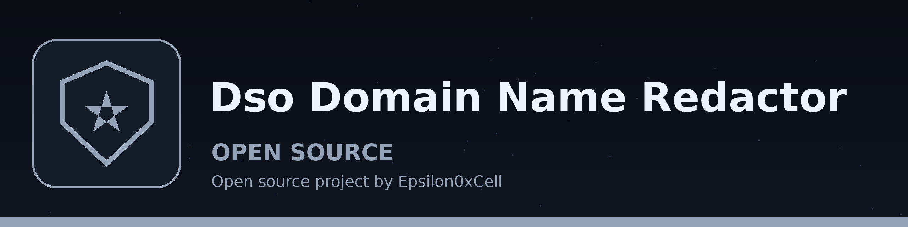

# dso-domain-name-redactor
Redacts domain names from a text file while preserving the TLD. This can be used to remove references to specific services while keeping the general category of each address.

## Install
`git clone https://github.com/ShadowGuard-AI/dso-domain-name-redactor`
Then install the packages in requirements.txt (faker and chardet).

## Usage
`python main.py input_file output_file [-l LANGUAGE] [-d]`

## Parameters
- `input_file`: Path to the input text file.
- `output_file`: Path to the output text file.
- `-l`, `--language`: Language locale for Faker (default: en_US).
- `-d`, `--debug`: Enable debug logging.
- `-h`: Show help message and exit.

## Behavior
- If the output path resolves to the input file, the run refuses and exits 1 before anything is written. This covers the same path, a ./ alias of it, and a symlink to it. The input file is left byte identical.
- Redactions are counted. If no domain is redacted, the run prints a plain "No domains redacted." line, writes no output file, and exits 1 instead of reporting completion.
- Only domain shaped tokens with a real suffix are redacted. The recognised suffixes are a fixed list of common public endings (for example com, net, org, edu, gov, io, ai, app, dev, and common country endings). Dotted tokens without a real suffix are left untouched, so sentence joins such as End.Start and file names such as file.txt pass through unchanged.
- One replacement is kept per distinct domain within a run, so repeated mentions of the same domain are replaced the same way every time.
- Host names with underscores are treated as domain shaped when they end in a real suffix, and the whole token is redacted as one domain. An underscored name is never partly redacted, so no fragment of it is left behind.

## License
Copyright (c) ShadowGuardAI
